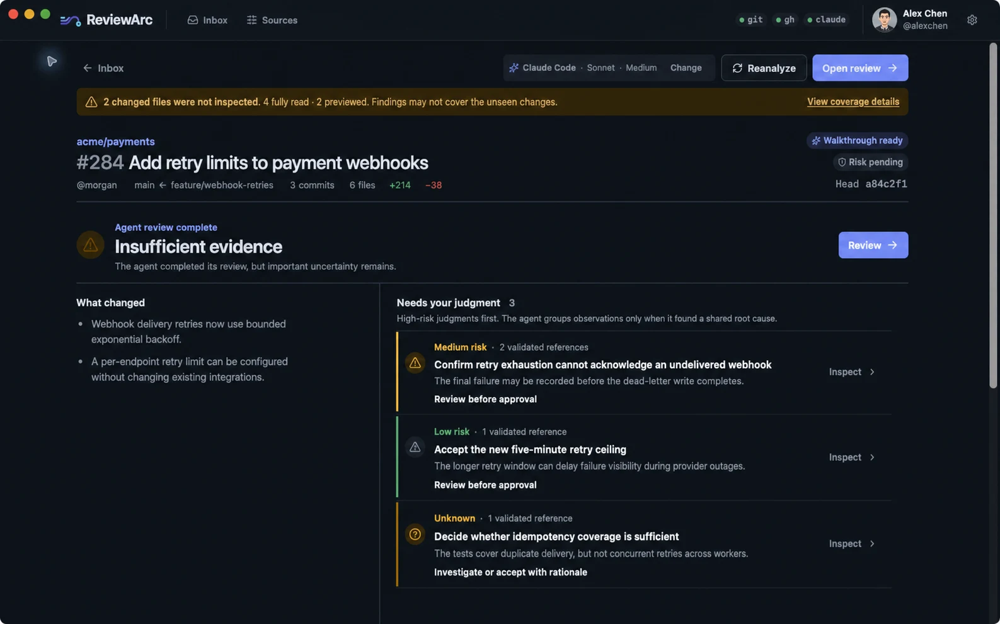

<p align="center">
  <a href="https://reviewarc.dev">
    
  </a>
</p>

<h1 align="center">ReviewArc</h1>

<p align="center">
  Agent-assisted pull request review where the evidence is checked and the approval stays yours.
</p>

<p align="center">
  <a href="https://github.com/strantalis/reviewarc/actions/workflows/ci.yml"></a>
  <a href="https://github.com/strantalis/reviewarc/releases"></a>
  <a href="LICENSE"></a>
  
</p>

<p align="center">
  <a href="https://reviewarc.dev">Website</a> ·
  <a href="https://reviewarc.dev/docs/">Documentation</a> ·
  <a href="https://reviewarc.dev/#download">Download</a> ·
  <a href="CONTRIBUTING.md">Contributing</a>
</p>

<p align="center">
  <a href="https://reviewarc.dev">
    
  </a>
</p>

ReviewArc is a local-first macOS application for reviewing GitHub pull requests with Codex or Claude Code. The agent performs the broad pass; ReviewArc verifies every cited path and line range against the exact revision; you decide what should block approval and what gets published to GitHub.

## Why ReviewArc

- **Review the decisions, not a wall of text.** Start with a recommendation, coverage, blind spots, and the findings that could change the outcome.
- **Check claims against real code.** Evidence links are validated against pinned Git objects before they become navigable.
- **Keep private work local.** Analysis, notes, drafts, and decisions remain on your Mac until you explicitly publish a review.
- **Protect the repository boundary.** Agent runs cannot execute project scripts, builds, tests, hooks, pushes, merges, or arbitrary shell commands.
- **Use your existing tools.** ReviewArc works with GitHub CLI and an authenticated Codex or Claude Code installation; it does not store GitHub tokens.

## How it works

1. Choose repositories or organizations to build a unified pull request inbox.
2. Open a pull request; ReviewArc fetches its exact base and head revisions into an application-managed cache.
3. Run an agent review after CI is ready. ReviewArc records coverage and validates cited evidence.
4. Resolve the consequential judgments, preview the exact GitHub review, and confirm before anything is published.

## Install

Download the latest signed and notarized universal macOS build from [reviewarc.dev](https://reviewarc.dev/#download).

ReviewArc expects these tools to be installed and available in your shell:

- [`git`](https://git-scm.com/)
- [GitHub CLI](https://cli.github.com/), authenticated with `gh auth login`
- For agent review, either [Codex CLI](https://learn.chatgpt.com/docs/codex/cli) or [Claude Code](https://code.claude.com/docs), installed and authenticated

An AI harness is optional if you only want to browse the inbox and existing reviews. See the [getting started guide](https://reviewarc.dev/docs/getting-started/) for setup and the first-review walkthrough.

## Security and privacy

Repository content, pull request text, and AI output are treated as untrusted input. ReviewArc uses fixed executable allowlists, argument arrays instead of shell command strings, application-owned Git storage, bounded read-only context tools, and explicit confirmation for the single publishing mutation.

Read the [security model](docs/security-model.md) for the trust boundaries and [security policy](.github/SECURITY.md) for private vulnerability reporting.

## Build from source

Development is supported on macOS with Xcode Command Line Tools, Go 1.26.5 or newer, Node.js 24, npm, Git, and GitHub CLI.

```sh
npm ci --prefix frontend
export REVIEWARC_DATA_DIR="$(mktemp -d "${TMPDIR:-/tmp}/reviewarc-dev.XXXXXX")"
go run github.com/wailsapp/wails/v2/cmd/wails@v2.13.0 dev
```

The isolated development data directory is not removed automatically. See [CONTRIBUTING.md](CONTRIBUTING.md) for the repository map, full validation command, generated-file rules, and contribution workflow.

## Project status

ReviewArc is in public beta. It currently supports GitHub.com through `gh`, macOS, and agent reviews through Codex or Claude Code. GitHub Enterprise configuration and team workspaces are not yet supported. ReviewArc deliberately does not run project commands as part of a review.

Browse [open issues](https://github.com/strantalis/reviewarc/issues) for planned work and known problems.

## Contributing

Start with an issue before opening an implementation pull request. ReviewArc uses a contributor trust list to keep changes scoped and maintainable; the process is documented in [CONTRIBUTING.md](CONTRIBUTING.md). Do not open a public issue for a suspected vulnerability—follow the [security policy](.github/SECURITY.md) instead.

## License

ReviewArc is licensed under the [Apache License 2.0](LICENSE). Third-party attributions are recorded in [THIRD_PARTY_NOTICES.txt](THIRD_PARTY_NOTICES.txt).
